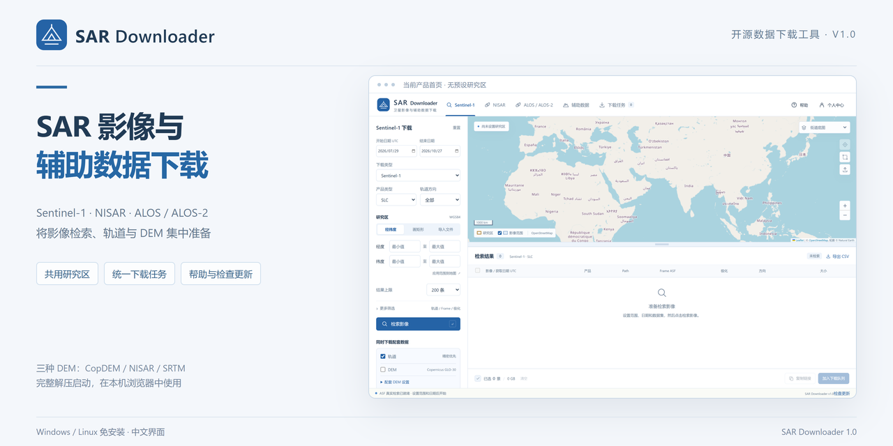
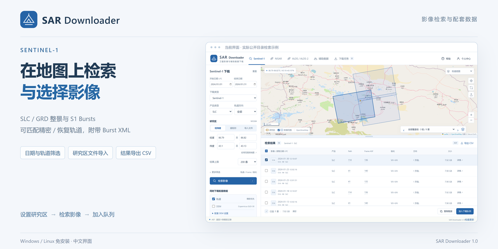
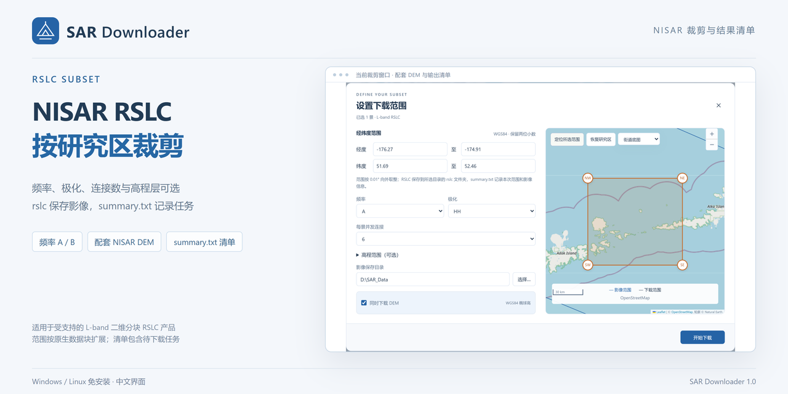
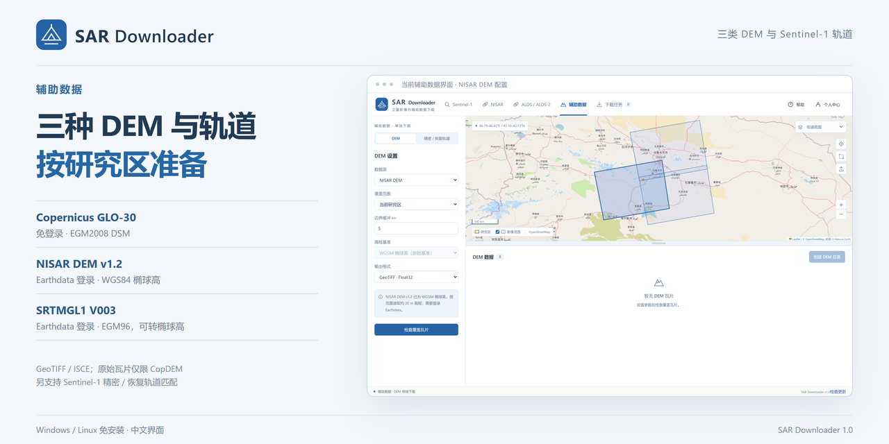

# SAR Downloader

**SAR 影像与辅助数据检索下载工具 · Windows / Linux 免安装版**

在同一个界面中准备 Sentinel-1、NISAR、ALOS / ALOS-2 影像，以及配套轨道和 DEM。支持地图研究区、统一下载任务、暂停续传及 NISAR RSLC 按研究区裁剪。

[下载免安装版](https://github.com/odlil/SAR-Downloader/releases/latest) · [PDF 使用说明书](docs/manual.pdf) · [快速开始](QUICKSTART.md) · [问题反馈](https://github.com/odlil/SAR-Downloader/issues)

## 下载与启动

普通用户请下载对应系统的免安装包，完整解压后运行。

| 平台 | 下载 | 启动方式 |
| --- | --- | --- |
| Windows x64 | [Windows 免安装版](https://github.com/odlil/SAR-Downloader/releases/download/v1.0/SAR-v1.0-windows-x64.zip) | 进入 `SAR` 文件夹，双击 `SAR.exe` |
| Linux x86_64 | [Linux 免安装版](https://github.com/odlil/SAR-Downloader/releases/download/v1.0/SAR-v1.0-linux-x86_64.tar.gz) | 进入 `SAR` 文件夹，运行 `./SAR` |
| 开发者 | [源码包](https://github.com/odlil/SAR-Downloader/releases/download/v1.0/SAR-v1.0-source.zip) | 按[开发与配置说明](docs/DEVELOPMENT.md)准备环境 |

免安装包自带运行环境，无需自行安装 Python、Conda、GDAL 或 sardem。请保留程序目录中的 `_internal`、`dem-engine` 等配套文件夹。Linux 版本需要 glibc 2.35+，原生文件选择器需要图形会话。

GitHub 的 **Code → Download ZIP** 是源码下载入口；运行免安装软件请选择上方对应平台的程序包。

## 可以做什么

| 模块 | 主要功能 |
| --- | --- |
| Sentinel-1 | 检索下载整景 SLC / GRD 与 S1 Bursts，可匹配精密 / 恢复轨道，Bursts 可附带 XML |
| NISAR | RSLC / GSLC / GCOV / GUNW 整景下载，以及受支持 RSLC 产品的范围裁剪 |
| ALOS / ALOS-2 | 检索下载支持的 ALOS 产品与 ASF 公开的 ALOS-2 ScanSAR L1.1 产品 |
| 研究区 | 经纬度输入、地图绘制、SHP / KML / KMZ / GeoJSON 导入；多个模块共用研究区 |
| 辅助数据 | Sentinel-1 轨道匹配，以及三种 DEM 数据准备 |
| 下载任务 | 统一队列、下载前检查、进度显示、暂停、继续、重试与状态恢复 |
| 帮助与更新 | 内置离线 PDF 说明书；手动检查 GitHub 正式版本并提供下载入口 |

## 在地图上检索与选择影像

按研究范围、日期、产品类型和轨道等条件筛选数据，结合覆盖面与结果列表选择影像，并支持导出 CSV。

## NISAR RSLC 按研究区裁剪

支持选择频率、极化、连接数与高程层，可同时准备 NISAR DEM。新裁剪影像保存至 `rslc` 子目录，根目录 `summary.txt` 记录范围、影像信息和任务状态。

裁剪仅适用于受支持的 L-band 二维分块 RSLC 产品。范围使用研究区外包矩形，并按原生雷达数据块扩展；导入多边形不会逐像元掩膜。`summary.txt` 包含已提交任务，待下载记录不代表下载完成。

## 三种 DEM 与配套轨道

| 数据源 | 原始高程基准 | 登录要求 |
| --- | --- | --- |
| Copernicus GLO-30 | EGM2008，原始数据为 DSM | 无需 Earthdata 登录 |
| NISAR DEM v1.2 | WGS84 椭球高 | 需要 Earthdata 登录 |
| SRTMGL1 V003 | EGM96，可转换为 WGS84 椭球高 | 需要 Earthdata 登录 |

支持研究区缓冲、高程设置及 GeoTIFF / ISCE 输出；原始瓦片下载仅适用于 Copernicus。SRTM 覆盖南纬 56°至北纬 60°陆地，实际可用性以源站为准。

## 第一次使用

1. 完整解压并启动对应系统的程序，软件会在本机浏览器打开。
2. 输入经纬度、绘制矩形，或导入研究区文件。
3. 选择数据集和日期，点击检索并勾选需要的数据。
4. 设置保存目录；下载需要授权的数据前，登录自己的 NASA Earthdata 账号并完成源站授权。
5. 创建任务，开始下载；需要时在下载任务页面暂停、继续或重试。

第一次打开不会预设研究区或自动检索。详细操作见[使用说明书](docs/manual.pdf)，也可在软件右上角点击“帮助”。

## 使用说明

- 当前免安装包面向 Windows x64 和 Linux x86_64，未提供 macOS、ARM64 或 Alpine/musl 版本。
- 在线检索与下载需要联网，实际可用性受网络、源站服务及账号授权影响。
- 软件在本地运行；同一后台的多个浏览器页面共用任务队列。
- “检查更新”提供版本查询和浏览器下载入口，更新程序前需暂停任务并退出旧程序，再完整解压新版。
- 免安装程序尚未进行代码签名；下游科学处理兼容性需要在实际流程中验证。

## 开发与许可

项目使用 Python、HTML / CSS / JavaScript 和 Leaflet，结合 Shapely、PyProj、Requests、h5py、NumPy、GDAL 与 sardem 实现相关功能。

本工具整合了 `sar-workbench` 的检索、整景、轨道与 DEM 能力，以及 `nisar-rslc-downloader` 的 RSLC 分块裁剪引擎，原项目运行目录无需随本工具部署。

[开发与配置说明](docs/DEVELOPMENT.md) · [发布说明](RELEASE_NOTES.md) · [构建与发布](RELEASING.md) · [第三方组件说明](THIRD_PARTY_NOTICES.md)

项目源码采用 [MIT License](LICENSE)，第三方组件遵循各自许可证。
